<!-- ===================== HEADER ===================== -->
<p align="center">
  
</p>

<!-- ===================== TYPING ===================== -->
<p align="center">
  <a href="https://git.io/typing-svg">
    
  </a>
</p>

<p align="center">
  
  
</p>


## 👋 About me

```java
public class Maurice {

    private final String role = "Computer Science B.Sc. Student";

    private final String[] interests = {
        "Software Architecture",
        "DevOps"
    };

    private final String[] currentlyLearning = {
        "Backend Architecture",
        "Clean Code",
        "CI/CD"
    };
}
```


## 🎓 Study Progress

<p align="center">
  
</p>


## 🛠️ Tech Stack

<p align="center">
  <a href="https://skillicons.dev">
    
  </a>
</p>

<div align="center">

| ⚙️ Backend | 🗄️ Database | 🐳 DevOps & OS | 🎨 Frontend |
|:---:|:---:|:---:|:---:|
|  |  |  |  |
|  | |  | |

</div>


## 📚 Currently learning

<p align="center">
  
  
  
</p>


## 🚀 Projects

<!-- Projects will be added here -->

<!-- ===================== FOOTER ===================== -->
<p align="center">
  
</p>
